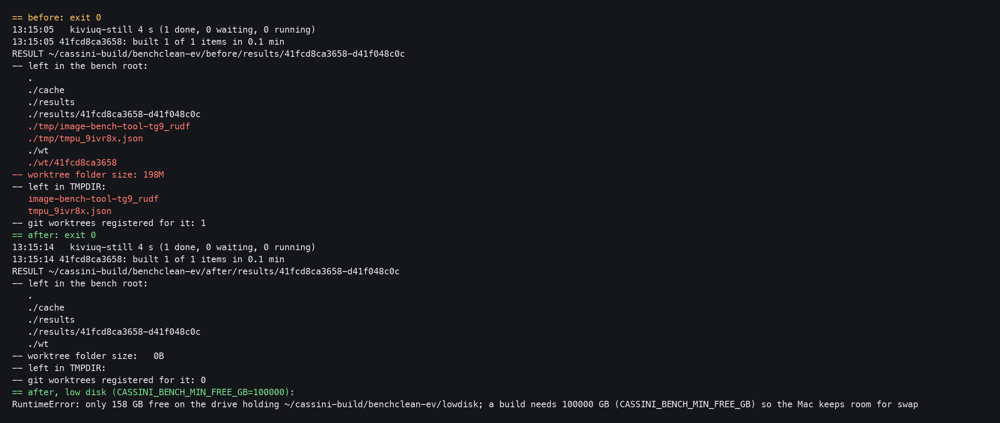

# Image benchmark cleans up after itself

One-item build (`kiviuq-still`) of 41fcd8ca, with the tool before and after this change, each into its own root
(`~/cassini-build/benchclean-ev/run.sh`, run under the heavy limiter on the MacBook, 2026-11-16).

- **Before:** the build leaves the commit's whole worktree (198 MB, registered with git), the tool copy and the
  resolve list in the temp folder. Across the MacBook's benchmark root that had grown to about 70 worktrees.
- **After:** only `results/` stays. The worktree is removed and unregistered, and the temp folder is empty.
- The picture is byte-identical (`kiviuq_still_same_bytes_before_and_after.webp`).
- With `CASSINI_BENCH_MIN_FREE_GB` above the free space, a build refuses to start and says why.

Full text: `disk_left_behind.txt`.
