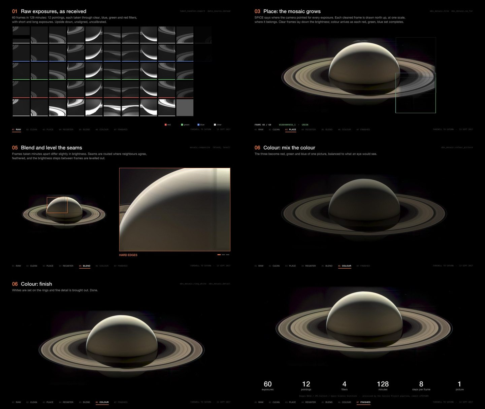

# Mosaic explainer animation

An 84 second film that shows everything the pipeline does to turn 60 raw exposures into one mosaic, on
`ISS_293SA_FAREWELL001_PRIME` (wide-angle camera, 13 September 2017: the Farewell to Saturn mosaic, 12 pointings in
clear, red, green and blue).



The video itself is not in the repo (project folder: `mosaic_explainer_draft1.mp4`).

## Nothing is re-implemented

`capture.py` saves each stage from the pipeline's own calls; `animate.py` only crops, resizes, cross-fades and labels
those files.

| Chapter | Call | How it is captured |
|---|---|---|
| 01 raw | `label_handler.label(...).export()` read by `data_source.imread` | the archive codes as stored |
| 02 clean one frame | `color_image.processed_frame` | run once per step inside `calibration.stepping`, the steps turned on one at a time (fill, calibrate, twohz, dark, pairs, flat, hotpix, skysmooth, stack/hdr, geom); steps that change nothing on this frame are not shown |
| 02 clean every frame | `color_image.processed_frame` | every frame alone, all steps on |
| 03 place | `obs_mosaic.layout` + `obs_mosaic.so_far(u, n)` for n = 0..59 | the mosaic after each tile; outlines are the tiles' own `outline` |
| 04 register | `so_far` inside `calibration.stepping(["panels", "surface", "blend", "level"])` against `["blend", "level"]` | SPICE places only, then registered |
| 05 blend and level | `so_far` with `blend`, `level` off, then `level` off, then everything on | |
| 06 colour | `filter_mosaic`, `colour_picture`, `ring_white`, `detail` | the real functions are wrapped while the finished `so_far` runs, and each return value is saved |
| 07 finished | `obs_mosaic.so_far(..., out=CANVAS)` | |

## Rerun

Private cache and a private copy of the geometry database; through the job limiter. About 5 minutes of one core on the
MacBook from an empty cache (tiles and the 60 growing mosaics 4 min, the rest under a minute), then 2 minutes to draw
the film.

```
python evidence/mosaic_explainer/capture.py W1884003566_6 OUT --cache CACHE \
    --hero W1884006326_2 --set W1884006524_1 W1884006458_1 W1884006392_1
python evidence/mosaic_explainer/animate.py OUT film.mp4
python evidence/mosaic_explainer/animate.py OUT "still_%s.jpg" --still 40 --still 82    # single frames
```

Made on main e755fd89.
