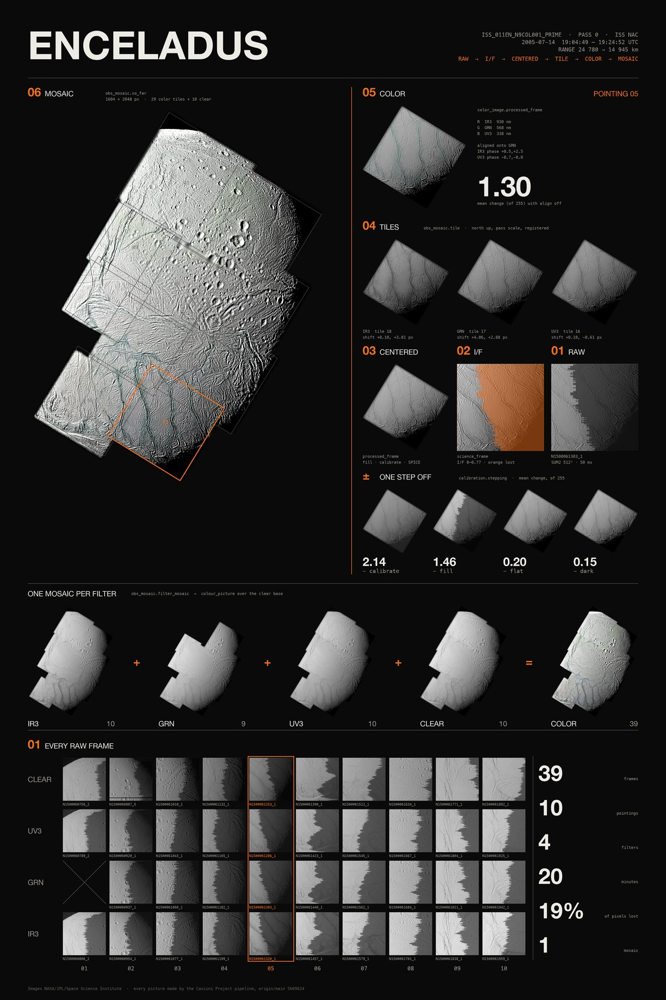
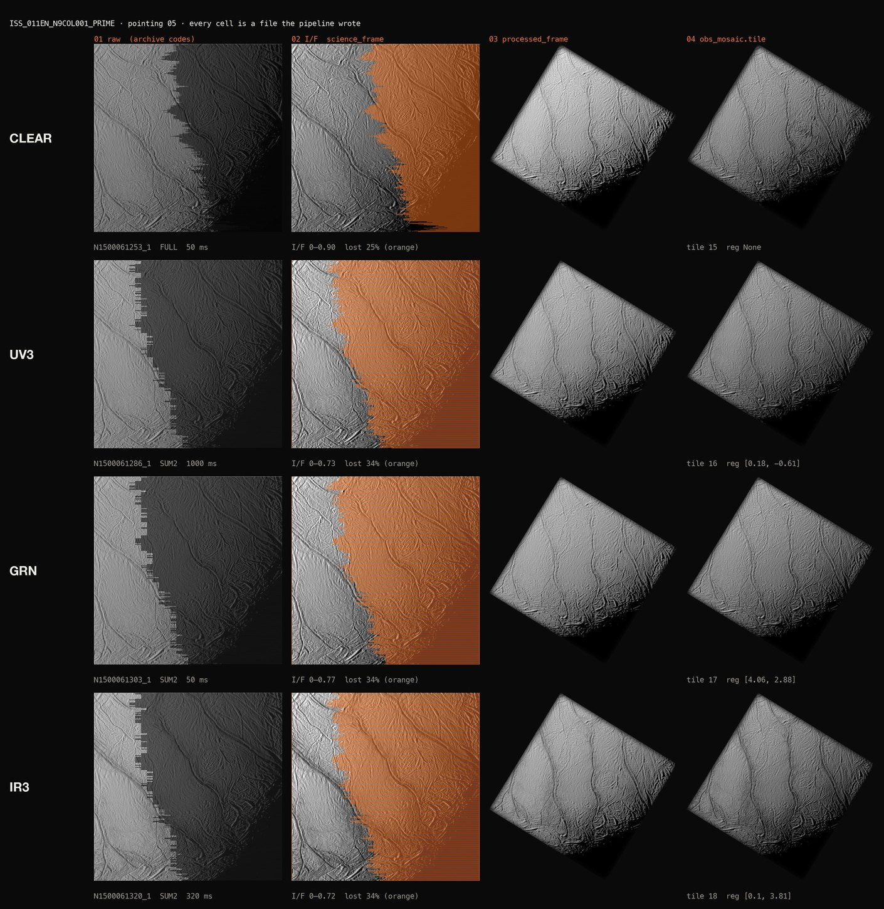
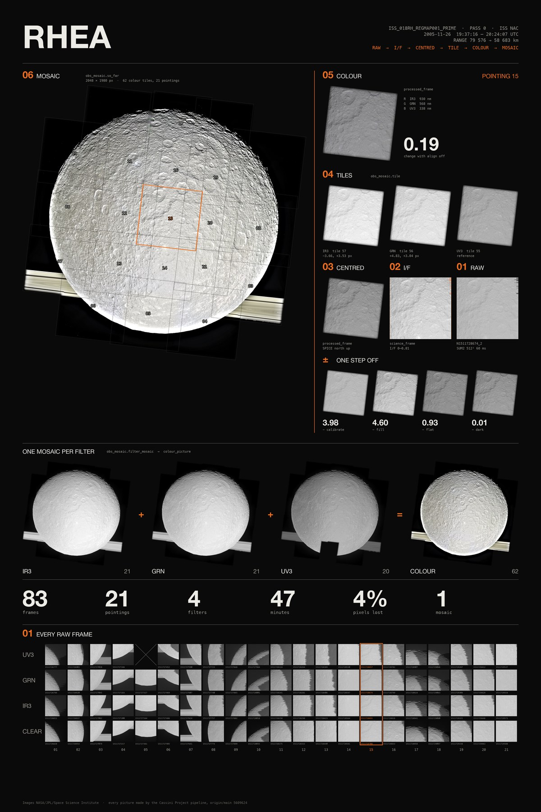

# Pipeline-stages posters

One mosaic, `ISS_011EN_N9COL001_PRIME` pass 0 (39 NAC frames, 10 pointings, CLEAR + UV3/GRN/IR3), shown at every
stage of the pipeline, then drilled down from the mosaic to one pointing (05, over the tiger stripes) and back to its
raw archive codes.



Every picture on the poster is a file a pipeline call wrote. Nothing is re-implemented. The poster script only crops
to alpha, resizes and sets type.

| Stage on poster | Call | Script |
|---|---|---|
| 01 raw, frame wall | `label_handler.label(...).export()` read by `data_source.imread` (archive codes) | `stages.py` |
| 02 I/F | `color_image.science_frame` (`calibration.calibrate`); lost pixels (NaN) drawn orange | `stages.py` |
| 03 centred | `color_image.processed_frame` (fill, calibrate, SPICE north-up) | `steps.py`, `centred.py` |
| ± one step off | the same call inside `calibration.stepping([step])`, with mean change against every step on | `steps.py` |
| 04 tiles | `obs_mosaic.tile` (pass scale, registration) | `tiles.py` |
| 05 colour | `color_image.processed_frame([IR3, GRN, UV3])` | `steps.py` |
| per-filter mosaics | `obs_mosaic.filter_mosaic` for IR3, GRN, UV3 and the clear base `L` | `mosaic_stage.py` |
| 06 mosaic | `obs_mosaic.so_far(..., out=CANVAS)`, 1604 × 2048, pasted 1:1 | `mosaic_stage.py` |

The pointing outlines and numbers come from `obs_mosaic.tile_map` (`tile_map.json`).



## Rerun

Use a fresh cache, never the live prebuild cache. Everything runs on one core at nice 10 and takes about 2 minutes:
tiles 39 s, mosaic 50 s, stages and steps about 1 minute.

```
source scripts/env.example.sh; export C     # T7 data zip, a T7 SPICE cache clone, a private geometry copy
$PY -I scripts/tiles.py N1500061959_1 $P/out
$PY -I scripts/mosaic_stage.py N1500061959_1 $P/out
$PY -I scripts/stages.py $P/out/frames <every id in out/unit.json>
$PY -I scripts/steps.py $P/out/steps N1500061303_1
$PY -I scripts/steps.py $P/out/steps N1500061320_1 N1500061303_1 N1500061286_1
$PY -I scripts/centred.py $P/out/steps N1500061253_1 N1500061286_1 N1500061320_1
$PY -I scripts/poster.py; $PY -I scripts/sheet.py
```

These figures were made on origin/main 5609624.

## Whole-disk version: Rhea, 26 November 2005

Sam asked for a complete mosaic. `scripts/fullscan.py` reads only the geometry cache and Image_index. For each pass it
compares the frame footprints (1024 px squares at the SPICE centring shift) against the body's disk, and keeps passes
that cover at least 97% of the disk with a disk wider than one frame. That gives 122 passes (`full_mosaics.json`). The
first one rendered is `ISS_018RH_REGMAP001_PRIME`: 83 frames, 21 pointings, IR3/GRN/UV3 plus clear, with the whole disk
and the rings behind it. `scripts/poster_full.py rhea/cfg.json` lays out the poster from the same stage scripts.



Known pipeline flaw, visible on the poster: a blurred grey strip at the top limb, in pointing 10.
